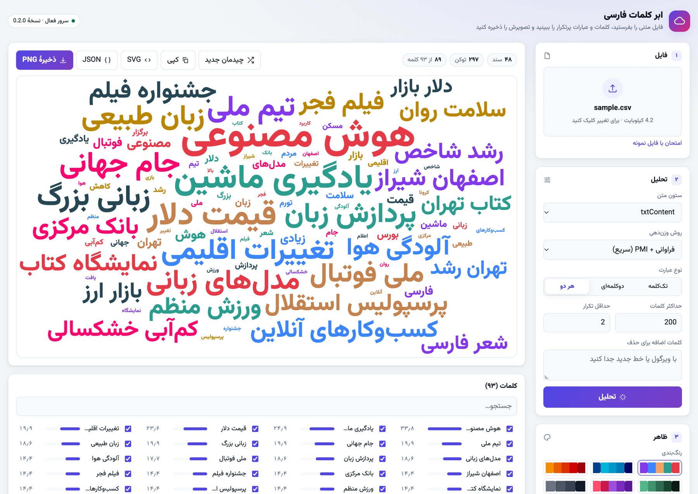
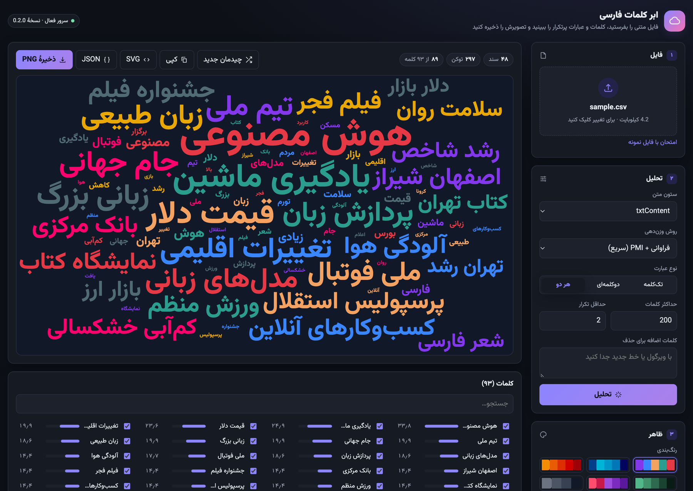
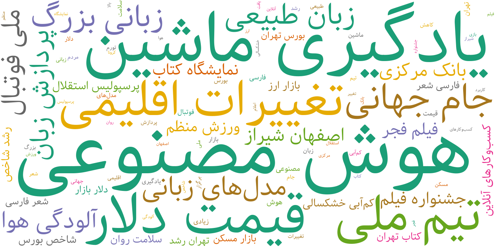

<div align="center">

# ☁️ Persian WordCloud

**Persian word clouds from your text files, with BERTopic + ParsBERT topic weighting**

Upload a CSV/TXT file and get an **interactive, animated word cloud** that you can
restyle live and save as PNG/SVG, from the **web app**, the **CLI**, or the **REST API**.

[](https://github.com/Persian-NLP-Toolkit/BERT-topic-modelling/actions/workflows/ci-cd.yml)


</div>

<p align="center">
  
  
</p>

---

## ✨ Features

| | |
|---|---|
| 🖱️ **Drag & drop** | CSV, TSV or TXT up to 20 MB; the text column is detected automatically |
| 🎞️ **Live, animated cloud** | words glide to their new position when you change settings |
| 🎨 **Restyle instantly** | 6 palettes, rotation, layout shape, font size and weight, background (incl. transparent); colours are adjusted automatically for contrast on light and dark backgrounds |
| 🧹 **Curate** | click a word in the cloud or untick it in the list to hide it; search terms; add extra stopwords |
| 💾 **Export** | high-resolution **PNG** (3×), **SVG**, **JSON** weights, or copy the image to the clipboard |
| 🧠 **Two weighting methods** | `frequency` (fast, count + PMI) and `bertopic` (ParsBERT embeddings + BERTopic, phrases from larger topics boosted) |
| 🔤 **Persian-aware** | normalises ي/ك → ی/ک, strips diacritics, URLs, mentions and digits, keeps ZWNJ words (`می‌شود`), built-in stopwords |
| 🌗 **RTL UI** | Vazirmatn font, light and dark themes, responsive down to mobile |
| ⌨️ **CLI & API** | the same pipeline from the terminal or over HTTP |
| 🐳 **Docker + CI/CD** | one image serves the API and the UI; GitHub Actions tests, builds, publishes to GHCR and creates releases |

---

## 🚀 Quick start

```bash
# 1. backend (Python ≥ 3.9, 3.12 recommended)
python3.12 -m venv .venv && source .venv/bin/activate
pip install -e ".[dev]"                 # add ".[bertopic]" for topic modelling

# 2. frontend (Node ≥ 20)
cd frontend && npm install && cd ..

# 3. run (two terminals)
bert-wordcloud serve --reload           # API  → http://127.0.0.1:8000
cd frontend && npm run dev              # UI   → http://localhost:5173
```

Open <http://localhost:5173/?sample>. The `?sample` parameter loads the bundled
sample file automatically.

> **Using a mirror?** Append `-i https://package-mirror.liara.ir/repository/pypi/simple`
> to `pip install` and `--registry=https://package-mirror.liara.ir/repository/npm/`
> to `npm install`.
>
> **Port 8000 busy?** Run `bert-wordcloud serve --port 8765` and start the UI with
> `VITE_API_PROXY=http://127.0.0.1:8765 npm run dev`.

---

## 📄 Input

| Format | Documents |
| ------ | --------- |
| `.csv` / `.tsv` | one per row; column `txtContent` by default, otherwise the column with the longest text (or choose it in the UI / pass `--column`) |
| `.txt` | one per line |

Example: [`examples/sample.csv`](examples/sample.csv) (48 short Persian news-style sentences).

---

## ⌨️ CLI

<p align="center"></p>

```bash
bert-wordcloud generate examples/sample.csv -o wordclouds/sample.png --top 10

# topic-weighted, bigrams only, extra stopwords, also dump the weights
bert-wordcloud generate data.csv -m bertopic -n 2 \
    --stopwords my-stopwords.txt --json wordclouds/terms.json

# weights only, no image
bert-wordcloud generate data.txt -o - --json terms.json
```

| Option | Default | Description |
| ------ | ------- | ----------- |
| `-o, --output` | `wordclouds/wordcloud.png` | PNG path, `-` to skip the image |
| `-c, --column` | `txtContent` / auto | text column |
| `-m, --method` | `frequency` | `frequency` or `bertopic` |
| `-n, --ngram` | `1-2` | `1`, `2` or `1-2` |
| `--max-words` | `200` | number of terms |
| `--min-count` | `2` | minimum occurrences |
| `--stopwords FILE` | | extra stopwords (comma or newline separated) |
| `--json FILE` | | write the weighted terms as JSON |
| `--top N` | | print the top N terms |
| `--width` `--height` `--background` `--colormap` `--font` `--transparent` | | image styling (any matplotlib colormap; bundled font: Gandom) |

`bert-wordcloud serve [--host --port --reload]` starts the API.
`python main.py data.csv` still works as an alias for `generate`.

---

## 🔌 API

```bash
curl -F file=@examples/sample.csv -F ngram=1-2 -F max_words=100 \
     http://127.0.0.1:8000/api/wordcloud
```

| Endpoint | |
| -------- | - |
| `GET /api/health` | version, whether BERTopic is installed, upload limit |
| `POST /api/wordcloud` | multipart form: `file` (required), `column`, `method`, `ngram`, `max_words`, `min_count`, `stopwords` |

```json
{
  "words": [{ "text": "هوش مصنوعی", "weight": 33.78 }],
  "method": "frequency", "documents": 48, "tokens": 297, "topics": 0,
  "warnings": [], "columns": ["id", "txtContent"], "column": "txtContent"
}
```

Interactive docs: <http://127.0.0.1:8000/docs>.

Environment variables: `MAX_UPLOAD_MB` (default 20), `CORS_ORIGINS` (default `*`),
`STATIC_DIR` (folder with a built UI to serve at `/`).

---

## 🧠 How terms are weighted

1. **Preprocess**: normalise, tokenise and drop stopwords.
2. **Count n-grams**: unigrams score their count. Bigrams score
   `count × PMI` and are kept only when PMI ≥ 1, so only real collocations such as
   *هوش مصنوعی* survive.
3. **`bertopic` method only**: documents are embedded with
   [ParsBERT](https://huggingface.co/HooshvareLab/bert-base-parsbert-uncased),
   reduced with UMAP and clustered by BERTopic. Each topic is counted separately and
   multiplied by a factor that favours larger topics. With fewer than 10 documents,
   or when every document is an outlier, the pipeline falls back to `frequency` and
   reports a warning.

---

## 🐳 Docker

```bash
docker build -t bert-wordcloud .                                   # lite (frequency only)
docker build -t bert-wordcloud:bertopic --build-arg EXTRAS=bertopic .
docker run -p 8000:8000 -v hf-cache:/data bert-wordcloud           # → http://localhost:8000
```

Mirrors: `--build-arg PIP_INDEX_URL=…` and `--build-arg NPM_REGISTRY=…`.

Prebuilt images: `ghcr.io/persian-nlp-toolkit/bert-topic-modelling:latest` and
`:latest-bertopic`.

---

## 🔁 CI/CD

[`.github/workflows/ci-cd.yml`](.github/workflows/ci-cd.yml)

| Job | Runs on | Does |
| --- | ------- | ---- |
| `python` | every push / PR | black, pytest on 3.10 & 3.12, CLI smoke test (uploads the sample image) |
| `frontend` | every push / PR | `tsc`, vitest, production build |
| `docker` | every push / PR | builds the lite and bertopic images and smoke-tests the API and UI. On `main` and `v*` tags it also **pushes to GHCR** |
| `release` | `v*` tags | builds the wheel with the UI bundled and attaches it to a GitHub Release |

```bash
git tag v0.2.0 && git push --tags      # publish a release
```

---

## 🧪 Tests

```bash
pytest -q                              # backend
cd frontend && npm test                # frontend
```

---

## 📁 Project layout

```
bert_wordcloud/        Python package
├── preprocess.py      normalisation + tokenisation
├── stopwords.py       built-in stopwords
├── ngrams.py          n-gram counting, PMI, topic weighting
├── pipeline.py        file loading, BERTopic, compute_frequencies()
├── embedder.py        ParsBERT embedder for BERTopic
├── render.py          PNG rendering (CLI)
├── api.py             FastAPI app
├── cli.py             `bert-wordcloud` command
└── fonts/Gandom.ttf
frontend/              React 19 + TypeScript + Vite
├── src/components/    WordCloud (d3-cloud + SVG), FileDrop, WordList, Icon
├── src/lib/           layout, colours / scaling, PNG & SVG export
└── public/sample.csv
tests/                 pytest suite
examples/              sample data
assets/                screenshots
```

---

## 📝 Notes

- ParsBERT is downloaded on the first BERTopic run (about 650 MB, cached in `HF_HOME`).
- Fonts: [Gandom](https://github.com/rastikerdar/gandom-font) for CLI images and
  [Vazirmatn](https://github.com/rastikerdar/vazirmatn) for the web UI.
- Word placement uses [d3-cloud](https://github.com/jasondavies/d3-cloud) v2.
